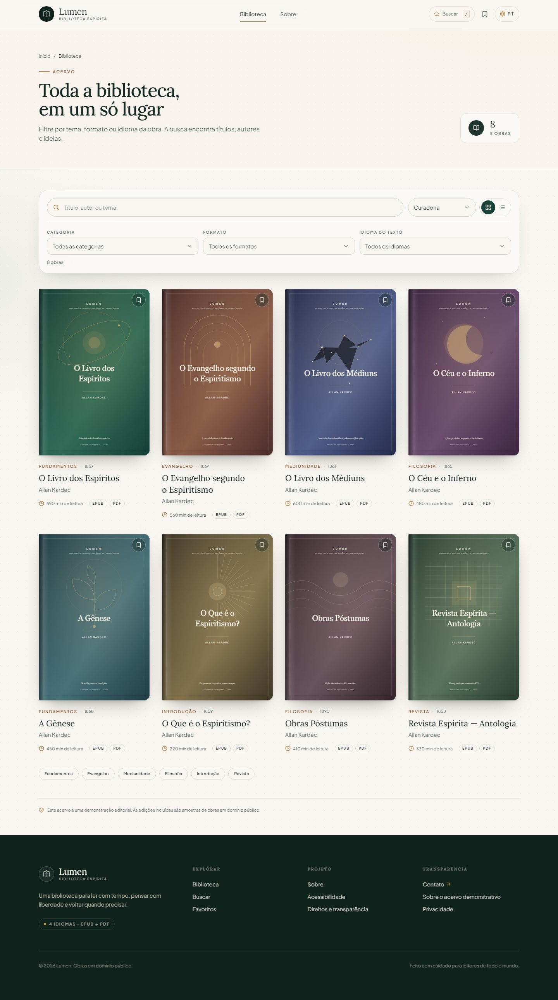
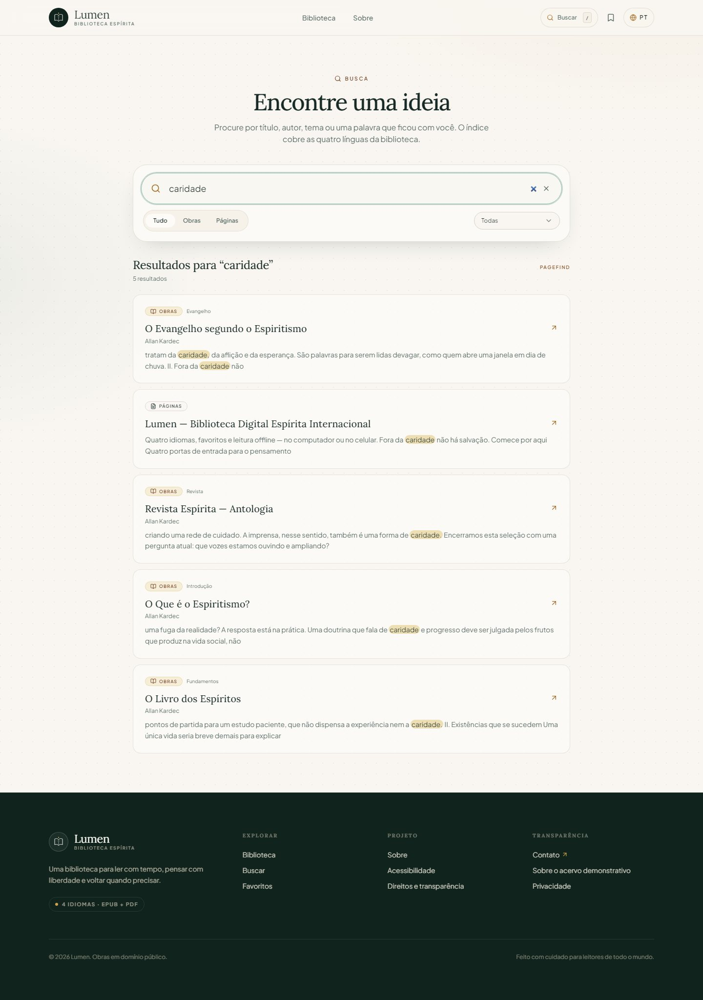
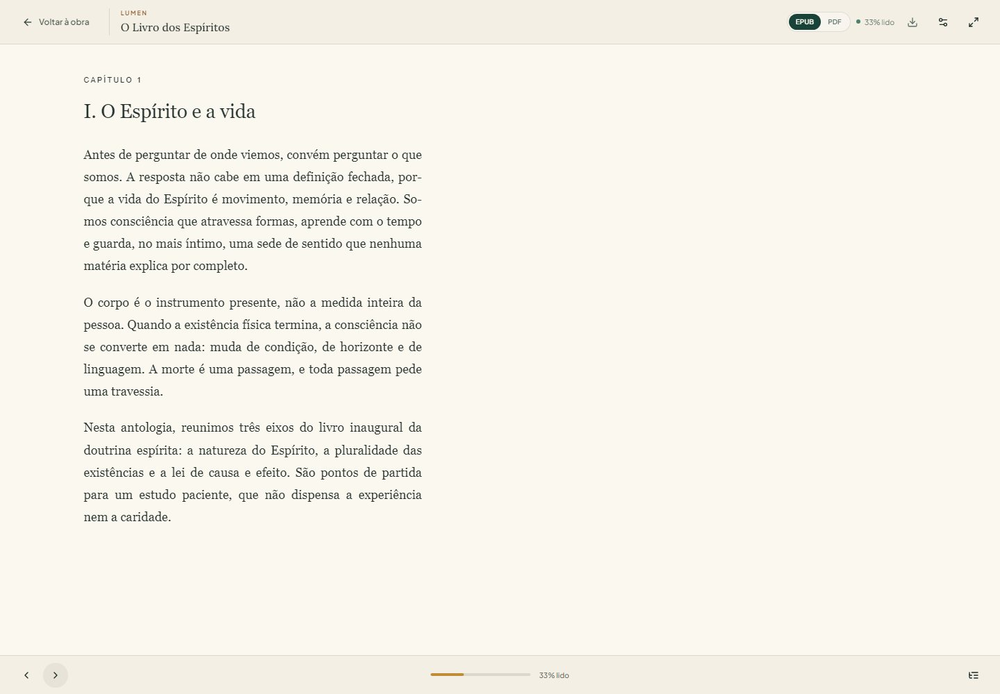

# Lumen — Biblioteca Digital Espírita Internacional

Uma biblioteca digital editorial para leitura de obras espíritas em **EPUB** e **PDF**, com interface em português, inglês, espanhol e francês. Este repositório entrega uma aplicação funcional de ponta a ponta: catálogo, leitores reais, favoritos persistentes, progresso de leitura, busca estática multilíngue e pipeline de qualidade.


## O que está pronto

- **Catálogo em quatro idiomas** (`/pt`, `/en`, `/es`, `/fr`) com metadados localizados, filtros combináveis, ordenação, visualização em grade/lista e páginas estáticas por obra.
- **Leitor EPUB** com epub.js + react-reader, sumário, navegação, temas (papel, sépia, noturno), tamanho de texto, tela cheia e retomada por CFI.
- **Leitor PDF** com react-pdf/PDF.js, renderização responsiva, navegação por página, zoom e retomada por página.
- **Progresso e favoritos locais** com Dexie/IndexedDB — sem cadastro e sem servidor para a estante.
- **Busca multilíngue Pagefind** sobre obras, descrições, sumários e metadados de fonte, com filtros por idioma, tipo e categoria.
- **Edição em português autorizada pela FEB**: _O Livro dos Médiuns_, com texto de Guillon Ribeiro, PDF/EPUB próprios, capa Lumen e avisos de licença.
- **Formulários validados** com react-hook-form + Zod: inscrição na carta editorial (persistência local) e contato com API local, honeypot e rate limit.
- **Design system próprio** baseado em Tailwind CSS e componentes shadcn/ui sobre Radix, com tipografia Plus Jakarta Sans + Lora, capas SVG geradas e identidade editorial consistente.
- **Acessibilidade** com navegação por teclado, skip link, foco visível, rótulos, `aria-pressed`, diálogos Radix, contraste e respeito a `prefers-reduced-motion`.
- **Qualidade automatizada**: ESLint, TypeScript `strict`, Prettier, Husky, lint-staged, commitlint, Vitest + Testing Library, Playwright e GitHub Actions.

> **Escopo do acervo:** as oito obras são **edições integrais em domínio público**, obtidas de Wikisource, Internet Archive e Project Gutenberg. _O Livro dos Médiuns_ também tem uma edição em português licenciada pela FEB, com texto de Guillon Ribeiro e projeto gráfico próprio. A fonte, a edição de origem, a licença e a data de captura estão no catálogo e em [`docs/content-sources.md`](docs/content-sources.md). Autores com direitos ativos aparecem apenas como perfis editoriais, sem textos hospedados.

## Telas

| Acervo                                                  | Busca                                             |
| ------------------------------------------------------- | ------------------------------------------------- |
|  |  |

| Leitor EPUB                                                | Experiência mobile                                             |
| ---------------------------------------------------------- | -------------------------------------------------------------- |
|  |  |

## Stack

| Camada       | Tecnologia                                                |
| ------------ | --------------------------------------------------------- |
| Framework    | Next.js 14.2 (App Router) + TypeScript `strict`           |
| UI           | Tailwind CSS 3.4, shadcn/ui, Radix UI, lucide-react       |
| Tipografia   | `next/font` — Plus Jakarta Sans (UI) e Lora (leitura)     |
| Estado       | Zustand (preferências do leitor)                          |
| Persistência | Dexie / IndexedDB (favoritos, progresso, carta editorial) |
| Formulários  | react-hook-form + Zod                                     |
| i18n         | next-intl, rotas prefixadas com detecção de idioma        |
| Leitura      | epub.js, react-reader, react-pdf, PDF.js                  |
| Busca        | Pagefind 1.5, índice estático multilíngue                 |
| Testes       | Vitest, Testing Library, Playwright                       |
| Qualidade    | ESLint, Prettier, Husky, lint-staged, commitlint          |
| CI           | GitHub Actions (lint + tipos + testes + build + e2e)      |

## Como rodar

Pré-requisitos: **Node.js 20+** e npm 10+.

```bash
npm install
npm run dev
```

Abra [http://localhost:3000](http://localhost:3000). O middleware redireciona `/` para o idioma detectado (ou `/pt`).

O `postinstall` copia o worker do PDF.js para `public/`. Os scripts `dev` e `build` geram o índice Pagefind em `public/pagefind/`, que é um artefato reproduzível e não versionado.

Para produção:

```bash
npm run build
npm start
```

Defina a URL pública em `.env.local`:

```bash
NEXT_PUBLIC_SITE_URL=https://sua-biblioteca.example
```

A variável alimenta canonical, `hreflang`, Open Graph, `sitemap.xml` e `robots.txt`.

## Scripts

| Comando                           | O que faz                                                 |
| --------------------------------- | --------------------------------------------------------- |
| `npm run dev`                     | Gera o índice de busca e inicia o Next em desenvolvimento |
| `npm run build`                   | Gera o índice, valida as edições e compila para produção  |
| `npm start`                       | Sobe o build de produção                                  |
| `npm run lint`                    | ESLint via `next lint`                                    |
| `npm run typecheck`               | `tsc --noEmit` em modo strict                             |
| `npm test`                        | Testes unitários e de componente (Vitest)                 |
| `npm run test:e2e`                | Fluxos críticos no Chromium (Playwright)                  |
| `npm run format` / `format:check` | Prettier                                                  |
| `npm run search:index`            | Reconstrói o índice Pagefind                              |
| `npm run sources:fetch`           | Baixa as fontes públicas para `content-sources/raw/`      |
| `npm run assets:generate`         | Reconstrói capas, EPUBs e o PDF a partir das fontes       |
| `npm run build:feb`               | Gera a edição PT autorizada da FEB (PDF + EPUB)           |
| `npm run verify:editions`         | Valida metadados, sumário, capa, idioma e hashes          |
| `npm run verify:feb`              | Valida a edição PT, capa, créditos e sumário              |
| `npm run assets:og`               | Regenera a imagem social `public/og.jpg`                  |

## Arquitetura

```text
.
├── content/
│   ├── books.json              # fonte canônica do acervo e das categorias
│   ├── editions.json           # estratégia de build e capítulos das fontes
│   ├── editions.lock.json      # hashes SHA-256, tamanho e contagem de seções
│   ├── toc.json                # sumários reais exibidos nas páginas das obras
│   └── authors.json            # perfis de autores com direitos ativos
├── scripts/
│   ├── build-search-index.mjs  # registros Pagefind por rota e idioma
│   ├── build-real-editions.mjs # capas SVG + EPUB 3 a partir das fontes
│   ├── validate-editions.mjs   # OPF, idioma, nav/NCX, capa, hash e PDF
│   ├── fetch-sources.mjs       # download reprodutível das fontes públicas
│   └── copy-pdf-worker.mjs     # assets do PDF.js após instalar
├── src/
│   ├── app/
│   │   ├── [locale]/
│   │   │   ├── (site)/         # shell com header/footer: casa, acervo, obra, busca, favoritos, sobre
│   │   │   └── ler/[slug]/     # experiência imersiva, sem chrome do site
│   │   ├── api/contact/        # endpoint Node com Zod, honeypot e rate limit
│   │   ├── manifest.ts, robots.ts, sitemap.ts
│   │   └── globals.css
│   ├── components/
│   │   ├── books/              # capa, card, grade, ações de leitura
│   │   ├── reader/             # shell, EPUB, PDF, loading
│   │   ├── site/               # header, footer, marca, idioma, favorito
│   │   └── ui/                 # primitivas shadcn/Radix
│   ├── content/books.ts        # tipos e consultas do acervo e do sumário
│   ├── content/authors.ts      # perfis de autores protegidos
│   ├── lib/                    # catálogo, DB, schemas, SEO, utils
│   ├── messages/               # pt, en, es, fr
│   ├── stores/reader-store.ts  # preferências persistidas
│   ├── i18n.ts, middleware.ts, navigation.ts
├── tests/
│   ├── unit/                   # lógica, schemas, store, componentes, mensagens
│   └── e2e/                    # navegação, catálogo, busca, leitores, favoritos
└── .github/workflows/ci.yml
```

### Rotas

| Rota                                     | Conteúdo                                                    |
| ---------------------------------------- | ----------------------------------------------------------- |
| `/[locale]`                              | Home editorial, destaque, categorias, princípios e carta    |
| `/[locale]/biblioteca`                   | Catálogo filtrável e ordenável                              |
| `/[locale]/livro/[slug]`                 | Detalhe, metadados, sumário real, fonte/licença e downloads |
| `/[locale]/ler/[slug]?formato=epub\|pdf` | Leitor imersivo                                             |
| `/[locale]/busca`                        | Busca Pagefind com filtros                                  |
| `/[locale]/favoritos`                    | Estante local via IndexedDB                                 |
| `/[locale]/sobre`                        | Projeto, direitos, privacidade, FAQ e contato               |

### Decisões de engenharia

- **Route group `(site)`**: permite que o leitor ocupe a viewport inteira sem header/footer, sem duplicar layouts nem recorrer a CSS frágil.
- **Índice Pagefind próprio**: em vez de depender do diretório interno do Next, o script cria um registro explícito por rota/idioma via API Node do Pagefind. O índice fica determinístico e permite filtros tipados (`locale`, `type`, `category`, `format`).
- **Conteúdo como dado**: o acervo vive em JSON, fora dos componentes. Trocar ou acrescentar obras não exige tocar em páginas, leitores ou busca.
- **Assets reprodutíveis**: capas e edições integrais são geradas por script a partir de fontes públicas registradas em `content/editions.json`. Os binários finais são versionados para que clone + install já funcione; a origem, a licença e os hashes continuam auditáveis.
- **Persistência local primeiro**: favoritos e progresso nunca exigem login. A integração de sincronização futura pode ser adicionada sobre a camada Dexie, sem alterar a UI.
- **Preferências separadas de progresso**: Zustand guarda tema/tamanho de fonte (leve e síncrono); Dexie guarda fatos do livro (posição, página, percentual). Cada um no lugar certo.
- **Busca carregada sob demanda**: Pagefind só é importado quando há consulta, mantendo o First Load JS da página em ~190 kB.

## Adicionando uma obra

1. Acrescente o registro em `content/books.json` com título/subtítulo/descrição nos quatro idiomas, categoria, ano, paleta, motivo da capa, formatos e bloco `source`.
2. Descreva a estratégia em `content/editions.json` (`wikisource`, `ocr` ou `copy-epub`) e, quando aplicável, as linhas de início dos capítulos.
3. Rode `npm run sources:fetch` para baixar a fonte pública e `npm run assets:generate` para criar `public/covers/<slug>.svg`, `public/books/<slug>.epub` e o PDF.
4. Rode `npm run verify:editions` e `npm run search:index` (ou apenas `npm run build`).
5. Valide com `npm test` e `npm run test:e2e` e registre a procedência em `docs/content-sources.md`.

O schema fica em `src/content/books.ts`; a página de detalhe, os cards, o catálogo e o índice leem a mesma fonte.

## Leitura e persistência

Tabelas Dexie (`lumen-library`):

| Tabela            | Chave                   | Conteúdo                                   |
| ----------------- | ----------------------- | ------------------------------------------ |
| `favorites`       | `bookId`                | obras guardadas e data                     |
| `readingProgress` | `id` (`bookId:formato`) | CFI/página, total, percentual, atualização |
| `newsletter`      | `email`                 | inscrição demonstrativa local              |

Preferências do leitor usam `localStorage` (`lumen-reader-preferences`), versionadas pelo `persist` do Zustand. O progresso do EPUB é restaurado por CFI; o do PDF, por número de página. A gravação é debounced e há flush ao desmontar/ocultar a aba.

## Busca

O índice é gerado com a API Node do Pagefind a partir de 44 registros: **3 páginas + 8 obras por idioma**. O conteúdo inclui metadados localizados, fonte, licença e os títulos reais do sumário de cada edição. O cliente:

1. importa `/pagefind/pagefind.js` apenas quando necessário;
2. aplica filtros `locale`, `type` e `category`;
3. sanitiza o HTML do trecho, permitindo apenas `<mark>`;
4. atualiza a URL com a consulta sem recarregar.

## i18n

- `next-intl` com prefixo obrigatório: `/pt`, `/en`, `/es`, `/fr`.
- Detecção por `Accept-Language` na raiz, com fallback `pt`.
- Metadados canônicos e `hreflang` por rota.
- Os quatro catálogos de mensagens têm teste automatizado de paridade de chaves e ausência de strings vazias.

## Qualidade

```bash
npm run format:check
npm run lint
npm run typecheck
npm test
npm run build
npm run test:e2e
```

- **Unitários/componentes:** filtros do catálogo, schemas, store do leitor, paridade de mensagens, card de obra e newsletter (validação + persistência mockada).
- **E2E:** redirecionamento de locale, troca de idioma, filtros e deep links, busca Pagefind, leitor EPUB (tema, sumário e navegação), leitor PDF de 164 páginas (paginação e largura responsiva), troca de formato, favoritos com persistência após reload.
- **Hooks:** `pre-commit` roda lint-staged; `commit-msg` aplica Conventional Commits.
- **CI:** dois jobs no GitHub Actions — qualidade/build e Playwright com Chromium.

## Acessibilidade

- HTML semântico, skip link e landmarks.
- Componentes Radix com gestão de foco e `Esc`.
- Alvos de toque com pelo menos 36–40 px; contraste de texto revisado.
- Estado de favorito via `aria-pressed`; progresso com `role="progressbar"`.
- Temas do leitor com contraste próprio; seleção de texto visível.
- `prefers-reduced-motion` desliga animações e transições.

## Segurança e privacidade

- Sem analytics, cookies de publicidade ou chamadas a terceiros em runtime.
- Validação Zod no cliente e no servidor; honeypot e rate limit em memória no contato.
- Trechos de busca sanitizados; JSON-LD serializado com escape de `<`.
- Cabeçalhos `nosniff`, `Referrer-Policy`, `X-Frame-Options` e `Permissions-Policy`.
- Nenhum segredo no cliente. O endpoint de contato grava em `.data/contact.jsonl` (ignorado pelo Git) e deve ser trocado por um provedor/queue em produção.

## Limitações conhecidas

- As edições são integrais, mas não são edições críticas. Os textos franceses do Internet Archive passaram por OCR e podem conter erros residuais; a transcrição de _O Livro dos Espíritos_ vem do Wikisource e está sob CC BY-SA 4.0.
- A “carta editorial” persiste apenas localmente na demonstração; não há envio de e-mail.
- O contato grava em disco local, apropriado para execução local/self-hosted, não para serverless somente-leitura.
- Não há autenticação, sincronização entre dispositivos, anotações ou DRM.
- O leitor EPUB cobre obras reflowable; layouts fixos e EPUBs protegidos não são suportados.
- O PDF é exibido página a página, com zoom; não há seleção contínua de múltiplas páginas.
- O acervo hospedado está em francês e inglês, nos idiomas originais, com _O Livro dos Médiuns_ também em português; títulos, sinopses e interface existem em quatro idiomas. Não hospedamos traduções modernas sem licença.

## Próximos passos naturais

- Ampliar o acervo com novas edições originais em domínio público e revisar o OCR contra os fac-símiles.
- Sincronização opcional de favoritos/progresso (Supabase, PocketBase ou API própria).
- Anotações e destaques com exportação.
- Integração da newsletter com provedor real e double opt-in.
- Testes de acessibilidade automatizados com axe e auditoria Lighthouse no CI.
- Cache offline de EPUB/PDF via Service Worker para leitura sem rede.

## Direitos

O código da aplicação está sob [MIT](LICENSE). As obras originais de Allan Kardec, Camille Flammarion e Arthur Conan Doyle estão em domínio público; a transcrição de _Le Livre des Esprits_ usada no EPUB é CC BY-SA 4.0 e mantém sua atribuição. A edição em português de _O Livro dos Médiuns_ usa a tradução de Guillon Ribeiro com autorização da FEB, registrada em [`docs/licenses/feb-2026.md`](docs/licenses/feb-2026.md); o texto não foi alterado e a capa/projeto gráfico são da Lumen. Capas, descrições, seleções e identidade Lumen são produções editoriais e não estão cobertas pela licença MIT do código. Textos de Chico Xavier, Divaldo Pereira Franco e Yvonne do Amaral Pereira não são hospedados; consulte as editoras oficiais.

---

Feito com cuidado para leitores de todo o mundo.
